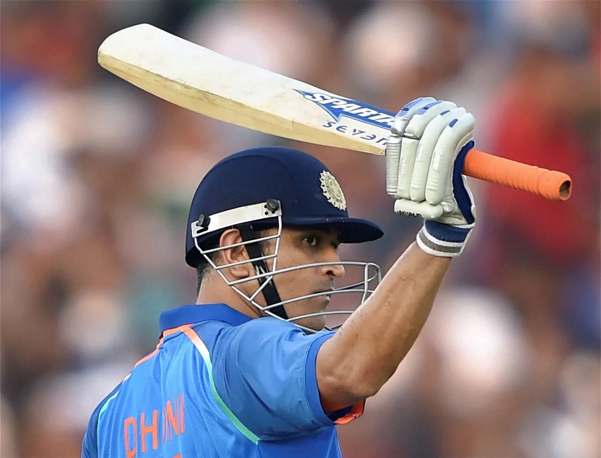

# MS Dhoni - The Legend | Cinematic Tribute Website



A premium, interactive, and cinematic tribute website dedicated to **Mahendra Singh Dhoni**, celebrating his legacy, achievements, and impact on world cricket. Built with modern web technologies to deliver an immersive fan experience.

## 🌟 Key Features

Design direction: **Floodlit Stadium**, a night match seen from the stands.

- **🏏 Live 3D hero**: a real-time WebGL cricket ball (procedural leather, seam and stitching) sits in the "O" of DHONI, reacts to the pointer and comes at the camera as you scroll.
- **↔️ Pinned journey**: vertical scroll drives a horizontal timeline of ten career milestones (stacks vertically on phones).
- **📊 Broadcast scoreboard**: count-up Test/ODI/T20I figures plus a catches-vs-stumpings split.
- **🎬 Highlight reel**: six compressed highlight packages that autoplay muted when in view.
- **🌀 Hall of Frames**: a draggable 3D ring of photographs with inertia and a keyboard/swipe lightbox.
- **🌍 Fan Globe**: a 3D dotted Earth (Natural Earth data) with fan pins and arcs drawn from Ranchi.
- **🧠 Pressure Mode & Captaincy Lab**: scenarios graded server-side, with optional AI feedback (Gemini / OpenRouter).
- **7️⃣ Thala for a Reason**, **🖼️ Supremacy Cards** (PNG export), **✒️ Fan Wall**, **📰 News**, **📅 On This Day**.
- Smooth scrolling (Lenis), a custom cursor, magnetic buttons, 3D tilt cards, split-text reveals; everything respects `prefers-reduced-motion`.

## 🛠️ Tech Stack

- **Framework**: Next.js 16 (App Router, Turbopack)
- **Styling**: Tailwind CSS 4 with design tokens in `src/app/globals.css`
- **Motion**: Framer Motion, Lenis
- **3D**: three.js via @react-three/fiber
- **Database**: MongoDB (Mongoose)
- **Fonts**: Big Shoulders (display) and Hanken Grotesk (body) via `next/font`

## 🖼️ Media

- `public/photos/`: curated WebP photographs (max 1800px). Captions/alt text live in `src/lib/photos.ts`.
- `public/reel/`: 720p H.264 highlight clips with WebP posters.
- `public/data/land-dots.bin`: precomputed land points for the fan globe.
- Archive photos from Wikimedia Commons are credited on `/credits`.

## 🚀 Getting Started

### Prerequisites

- Node.js 18+
- MongoDB Connection String (Atlas or Local)

### Installation

1.  **Clone the repository**:
    ```bash
    git clone https://github.com/your-username/ms-dhoni-tribute.git
    cd ms-dhoni-tribute
    ```

2.  **Install dependencies**:
    ```bash
    npm install
    ```

3.  **Set up Environment Variables**:
    Use `.env.example` as the single env template and copy values into Vercel Project Settings:
    ```env
    MONGODB_URI=your_mongodb_connection_string_here
    GNEWS_API_KEY=your_gnews_api_key_here
    GNEWS_QUERY=MS Dhoni OR Chennai Super Kings
    GNEWS_COUNTRY=in
    GNEWS_MAX_RESULTS=10
    GEMINI_API_KEY=optional
    GEMINI_MODEL=gemini-2.5-flash
    ```

4.  **Run the development server**:
    ```bash
    npm run dev
    ```

5.  Open [http://localhost:3000](http://localhost:3000) in your browser.

## 📂 Project Structure

```
src/
├── app/               # Routes (each page has a server page.tsx + client component)
│   └── api/           # fans, fan-map, news, on-this-day, pressure-scores, fan-universe/challenge
├── components/
│   ├── fx/            # Motion primitives: smooth scroll, cursor, reveals, tilt, lightbox
│   ├── three/         # WebGL scenes: BallScene, FanGlobe
│   ├── home/          # Home page sections
│   └── layout/        # Navbar, Footer, PageHero
├── lib/               # Content (dhoni.ts, photos.ts, quotes.ts), validation, db
└── models/            # Mongoose models
```

## 🌍 Deployment

The project is optimized for deployment on [Vercel](https://vercel.com).

1.  Push your code to GitHub.
2.  Import the project into Vercel.
3.  Add the `MONGODB_URI` environment variable in Vercel settings.
4.  Deploy!

## 👨‍💻 Created By

**Amritanshu Yadav**  
*A tribute to the greatest captain of all time.*

---
*"Definitively Thala."* 🦁💛

## "On this day" dataset

`src/data/dhoni-days.json` (and a flat `dhoni-days.csv`) lists every calendar day with a documented Dhoni memory: 866 events covering 348 of 366 days.

- **Matches:** 789 international and IPL games computed from [Cricsheet](https://cricsheet.org/) ball-by-ball data (ODC-BY). Each entry has his batting, keeping, bowling, the result, the venue and Player of the Match.
- **Life events:** hand-curated, sourced dates in `scripts/dhoni-days/life-events.json`. This file also adds landmark matches Cricsheet lacks (the 183\*, his Test debut, both Champions League titles).
- **Match stories:** `scripts/dhoni-days/match-notes.json`, keyed by Cricsheet match ID.
- **Photos:** each event carries a photo; `photoExact: false` marks illustrative ones.

To regenerate, download these Cricsheet archives into one folder, unzipped one per sub-folder: `india_male_json.zip`, `chennai_super_kings_male_json.zip`, `rising_pune_supergiant_male_json.zip`, `rising_pune_supergiants_male_json.zip`, `asia_xi_male_json.zip`. Then run `npm run data:days -- <folder>`.

## Fan deck

`/fan-deck` rebuilds the 2022 fan presentation ("MS DHONI 1.pptx", 167 slides) for the site: the D·H·O·N·I acronym, the "search for a replacement" gag, his own words, 38 original slides and a 2½-minute film of 35 slides. PowerPoint rendered the film with the deck's own transitions (`public/fan-deck/highlights.mp4`, 720p, silent).

`/the-greatest` expands each heading in the deck: The champion, Best wicketkeeper, Best captain, Best finisher, 2011 World Cup, His career (23 chapters), Captain & vice-captain, His bat, and Records. Each section pairs the deck's own pictures (`public/greatest/`) with figures from `src/lib/greatest.ts`, computed from the On This Day dataset.

## Quotes, friends and trophies

- **`/legacy` (Quotes):** tributes, each with the speaker's Wikimedia Commons portrait and a note on where the quote is recorded; Dhoni's own best lines in context; and the original fan collection, labelled as such (`src/lib/quotes.ts`).
- **`/friends`:**
  - Dhoni & Raina, Dhoni & Kohli and Dhoni & Jadeja, with partnership numbers computed ball by ball (`npm run data:partners -- <cricsheet-folder>` writes `src/data/partners.json`).
  - His top 12 batting partners.
  - Friends across cricket and beyond.
- **`/awards`:** every title as captain or player, plus individual honours. Player of the Match counts come from the dataset.
- **`/moments#captaincy`:** seven captaincy calls, each as situation, call and outcome.
- **Portraits:** `public/people/`, credited on `/credits` (`src/lib/people.ts`).

## Daily "On this day" email

Every morning at about 7:00 IST, Vercel Cron (`vercel.json`) calls `/api/cron/on-this-day-mail`. The route emails that day's events, sent from Gmail to everyone in `DIGEST_RECIPIENTS` as Bcc.

1. **Turn on 2-Step Verification** on the sending Gmail account, then create an **App password** at https://myaccount.google.com/apppasswords.
2. **Add these in Vercel** under Project → Settings → Environment Variables (Production), then redeploy:
   - `CRON_SECRET`: any long random string. Vercel sends it automatically on cron calls.
   - `GMAIL_USER` and `GMAIL_APP_PASSWORD`.
   - `DIGEST_RECIPIENTS`: comma-separated addresses.
   - `SITE_URL` (optional).
3. **Test it:**
   - Run it now from Vercel → Project → Settings → Cron Jobs → **Run**.
   - Or preview without sending: `curl -H "Authorization: Bearer $CRON_SECRET" "https://<site>/api/cron/on-this-day-mail?preview=1&d=04-02"`.

Email images are landscape JPEG cuts in `public/email/`. Run `npm run email:images` after adding photos.
